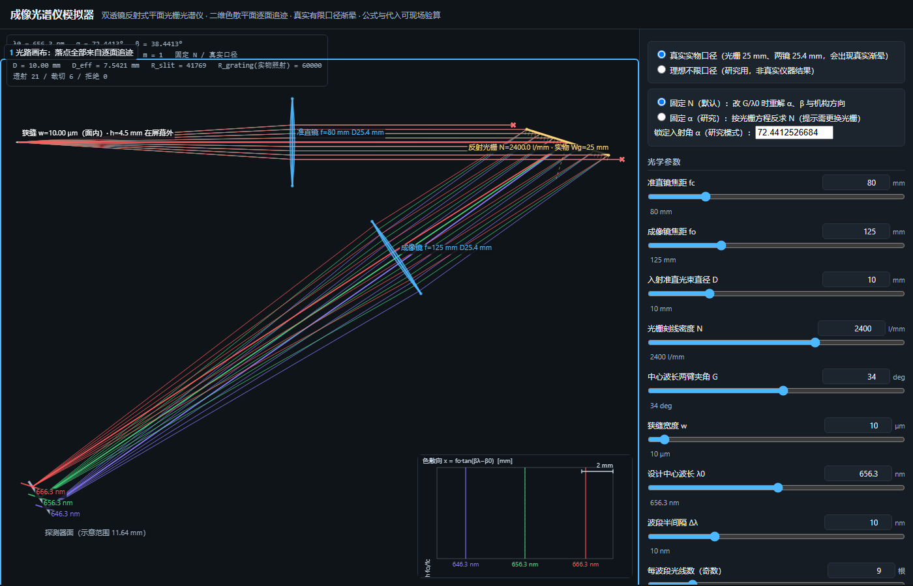
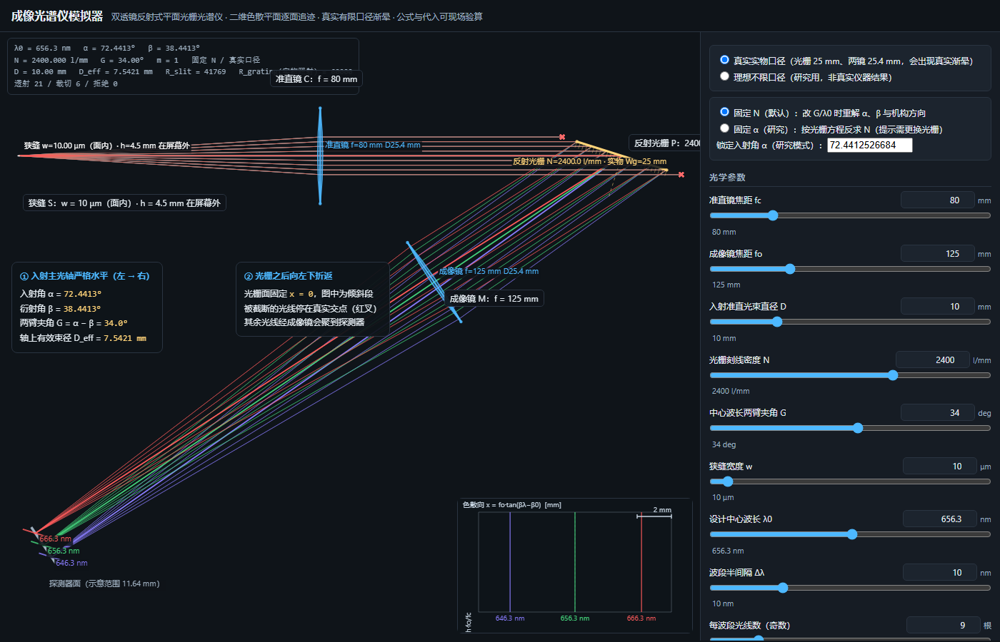
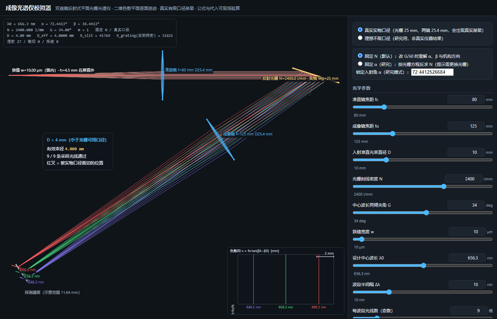
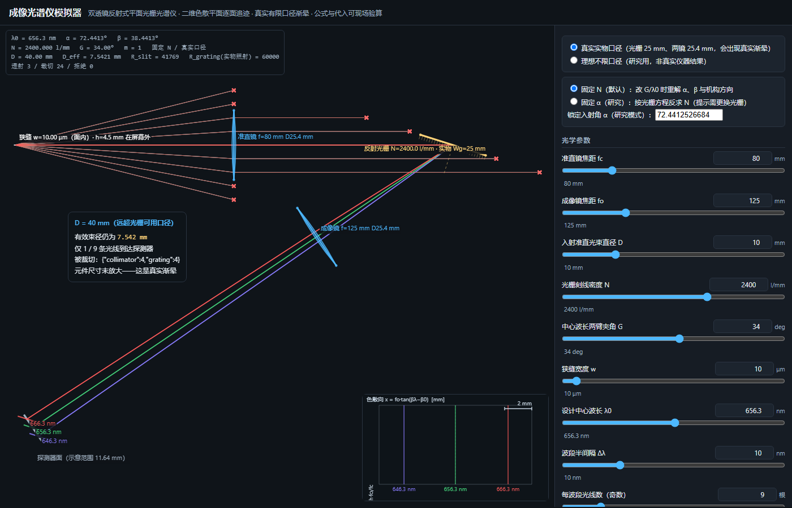
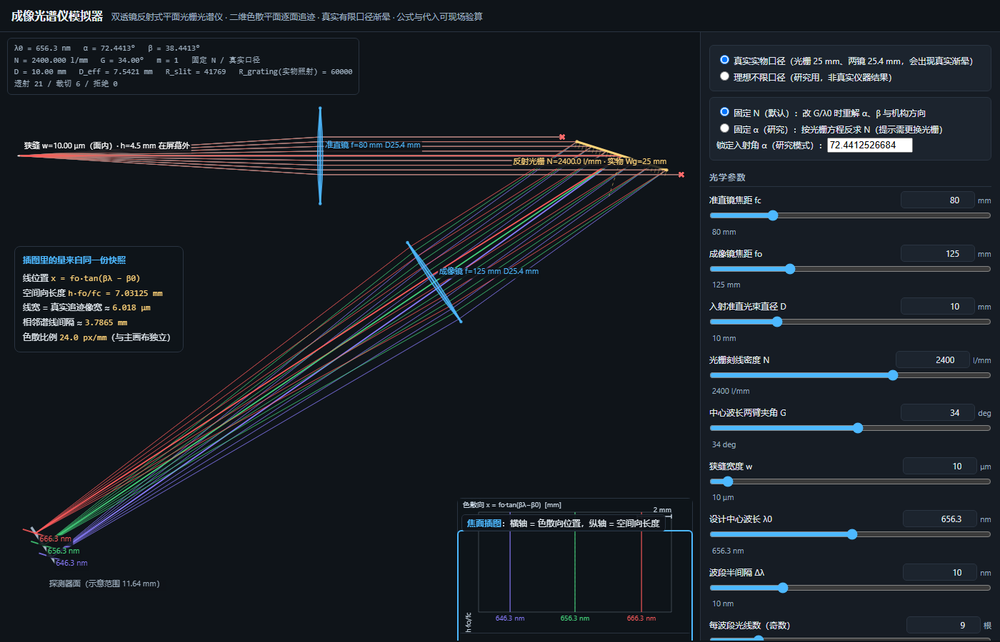
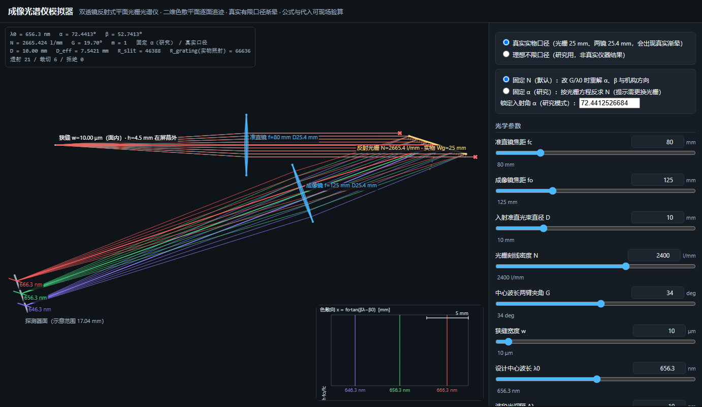
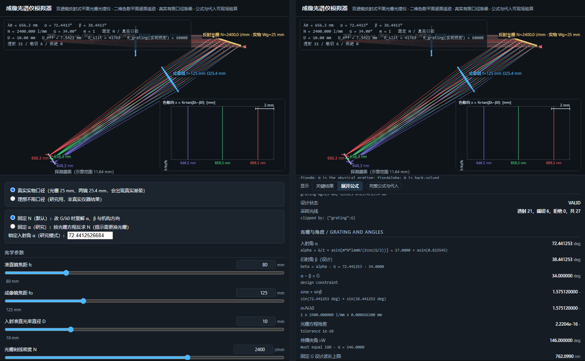

# 成像光谱仪模拟器

**双透镜反射式平面光栅光谱仪的二维光路模拟器 · 单文件离线网页版**

打开一个 HTML 文件，拖动滑条，即可看到狭缝 → 准直镜 → 反射光栅 → 成像镜 → 探测器的完整光路、
真实有限口径下的渐晕、三条谱线的焦面位置，以及每一个数值的**符号公式与数字代入过程**。

```text
无需安装、无需联网、无第三方依赖：双击 spectrometer-simulator.html 即可运行。
物理核心为纯 JavaScript，可在 Node 中直接测试；交付物由构建脚本从同一份源码内联生成。
```



---

## 目录

- [1. 功能一览](#1-功能一览)
- [2. 快速开始](#2-快速开始)
- [3. 界面分区](#3-界面分区)
- [4. 参数调整指南](#4-参数调整指南)
- [5. 两种约束模式](#5-两种约束模式)
- [6. 两种口径模式与真实渐晕](#6-两种口径模式与真实渐晕)
- [7. 面板显示模式（关键结果 / 展开公式）](#7-面板显示模式关键结果--展开公式)
- [8. 物理模型与关键公式](#8-物理模型与关键公式)
- [9. 验证状态](#9-验证状态)
- [10. 目录结构](#10-目录结构)
- [11. 延伸阅读](#11-延伸阅读)
- [12. 已知限制](#12-已知限制)

---

## 1. 功能一览

| 功能 | 说明 |
|---|---|
| **逐面光线追迹** | 狭缝 S → 准直镜 L → 光栅 Pg → 成像镜 Q → 探测器 X，每个交点由平面方程解出，不在画布上「凑」 |
| **真实有限口径** | 光栅 25×25 mm、两镜标称 25.4 mm；光线越界在**首次截断**处终止并标红叉，不放大元件迎合视觉 |
| **三波段同时显示** | λ0±Δλ 与 λ0，共用同一入射方向与机构位置，只按光栅方程分别求衍射方向 |
| **可审计公式** | 每个数值都给出符号式、数字代入与单位，可现场验算 |
| **焦面插图** | 色散向位置 `x = fo·tan(βλ−β0)`、空间向长度 `h·fo/fc`、线宽取真实追迹像宽 |
| **状态机** | `VALID / CROSS_NORMAL / CLIPPED_* / NO_REAL_SOLUTION / BACKSIDE_OR_GRAZING / NO_PROPAGATING_ORDER`，异常有明确原因 |
| **两种约束模式** | 固定刻线密度 N（默认）与固定入射角 α（研究模式） |
| **两种口径模式** | 真实实物口径（默认）与理想不限口径（研究用，明确标注非真实仪器结果） |
| **自动验收** | 数值/DOM 10 套件 + 真实浏览器像素套件，一条命令跑完 |

## 2. 快速开始

**方式一：直接使用（推荐）**

```text
1. 下载 spectrometer-simulator.html
2. 双击打开（Chrome / Edge / Firefox 均可）
3. 拖动右侧「光学参数」滑条，或在数值框输入后回车
```

即使断网、放在 U 盘里，也能正常使用。

**文件自检**

```text
单个 HTML 文件，约 119 KB；不含任何 <script src>、<link href> 或 http(s) 外链。
用文本编辑器搜索 “http” 只会命中注释里的说明文字，运行时不发起任何网络请求。
```

## 3. 界面分区


| 区域 | 内容 |
|---|---|
| **① 光路画布** | 元件、光轴、光线、裁切标记、探测器谱线；方位由显示投影决定（入射主轴恒为水平向左→右） |
| **② 模式开关** | 口径模式（真实 / 理想）与约束模式（固定 N / 固定 α） |
| **③ 光学参数** | 11 个滑条 + 数值框，双向联动，改动即时重算 |
| **④ 面板工具栏** | 「关键结果 / 展开公式」切换，附当前状态徽标 |
| **⑤ 焦面插图** | 右下角独立小图，展示三条谱线的位置、宽度与空间向长度 |
| **左上状态栏** | λ0 / α / β / N / G / 模式 / D_eff / 分辨力 / 透射-裁切-拒绝计数 |

### 光路读图要点



1. **狭缝 → 准直镜 → 光栅** 的主光轴严格水平、由左向右；狭缝到准直镜之间仍是发散束，准直之后才平行。
2. **反射光栅**是倾斜线段（固定在世界坐标 `x = 0` 平面），光线在**真实表面**上折转。
3. 折转后**向左下**：先经过成像镜，再会聚到探测器形成三条谱线。
4. **红叉**表示该光线被实物口径裁切，正是它的终止位置；被裁切的光线不会继续画向探测器。

## 4. 参数调整指南

| 参数 | 默认 | 范围 | 单位 | 物理含义与调整效果 |
|---|---:|---|---|---|
| 准直镜焦距 `fc` | 80 | 20–300 | mm | 决定狭缝到准直镜的距离与准直束角。放大 `fc` 会缩小同一狭缝的角扩散；狭缝像宽与 `fc` 成反比 |
| 成像镜焦距 `fo` | 125 | 20–400 | mm | 决定色散标尺与像宽：`dx/dλ ∝ fo`、`w_img ∝ fo`。放大 `fo` 会让三条谱线分得更开 |
| 入射准直光束直径 `D` | 10 | 1–40 | mm | **入瞳光束直径**，不是镜片直径。它决定光栅足印；超出光栅可用宽度即产生渐晕 |
| 光栅刻线密度 `N` | 2400 | 100–3600 | l/mm | 决定角色散 `dβ/dλ = m·N·1e−6/cosβ` 与设计入射角。改 `N` 会同时改变 α、β 与机构位置 |
| 两臂夹角 `G` | 34 | 5–60 | ° | 中心波长两光学臂夹角，`G = α − β`。改 `G` 会重新求解 α（固定 N 模式）或反求 N（固定 α 模式） |
| 狭缝宽度 `w` | 10 | 0.5–200 | μm | 面内狭缝宽度。直接决定像宽与几何分辨力 `R_slit ∝ 1/w` |
| 设计中心波长 `λ0` | 656.3 | 200–1100 | nm | Hα 线。改它会重新求解 α、β 与机构方向 |
| 波段半间隔 `Δλ` | 10 | 0–40 | nm | 三色为 `λ0±Δλ, λ0`。设为 0 时三条谱线重合 |
| 每波段光线数 | 9 | 1–51（奇数） | 根 | 孔径采样数；偶数自动进位为奇数，保证有中心主光线 |
| 准直镜—光栅距离 `Lc` | 80 | 1–400 | mm | **布局距离**，独立于 `fc`。示例值，非官方机械实测 |
| 光栅—成像镜距离 `Lo` | 60 | 1–400 | mm | **布局距离**，独立于 `fo`。示例值，非官方机械实测 |

### 调整示例

**把三条谱线拉开**：提高 `fo`（如 125 → 200）或提高 `N`。

**观察真实渐晕**：把 `D` 从 4 调到 40。




**看焦面细节**：把 `Δλ` 调到 40 nm，右下插图的三条线会明显分开。



## 5. 两种约束模式

> 这两者是**不同的物理约束**，不是同一种算式的两种写法。切换时界面会重新求解全部依赖量。

**固定 N（默认）**：光栅刻线密度是实物属性，不变。改变 `G` 或 `λ0` 时，重新求解 α、β 与机构方向。

**固定 α（研究模式）**：入射角锁定，按光栅方程反求**所需的** N：

```text
N_required = [sin(α_ref) + sin(α_ref − G)] / (m·λ0mm)
```

界面会明确提示「需更换光栅」——真实设备无法连续改变刻线密度。
在固定 α 模式下**直接编辑 N**，会自动切回固定 N 模式并同步滑条与数值框。



## 6. 两种口径模式与真实渐晕

| 模式 | 行为 |
|---|---|
| **真实实物口径（默认）** | 光栅 25 mm、两镜 25.4 mm 固定；光线按各自真实落点判定，越界即终止并标记 |
| **理想不限口径（研究用）** | 不做任何裁切，界面明确标注「非真实仪器结果」 |

> **本工具不会为了画面好看而放大元件或移动交点。**
> 默认参数下光栅足印为 33.15 mm，超过实物 25 mm，因此轴上有效束径只有 `D_eff = 7.542 mm`，
> 对应的色散面有效焦比约 f/10.6 —— 这就是 SoL’Ex 类仪器真实存在的渐晕。

## 7. 面板显示模式（关键结果 / 展开公式）

数值面板有两种显示模式，**窄窗口默认只显示关键指标**，点「展开公式」后再显示公式与数字代入：



- 窗口宽度 < 1100 px：默认「关键结果」；≥ 1100 px：默认「展开公式」。
- 手动切换后固定该选择，不再随窗口变化。
- **折叠只影响显示**：所有指标与公式始终在页面中，切换不会重新求解、不会丢数据。

## 8. 物理模型与关键公式

### 8.0 坐标与显示约定

物理世界坐标由规范固定：光栅面 `x = 0`、面内切向 `(0,1)`、指向元件侧法向 `(−1,0)`。
屏幕方位由**显示投影**决定：入射主光轴定义为水平、由左向右，光栅衍射后向左下折返（与官方光路图一致）。
投影是刚体变换（正交单位基，等比例、无翻面），**不改变任何物理量**——距离、夹角、交点与状态码都与世界坐标一致。

### 8.1 模型等级

**二维色散平面内的理想薄透镜 + 理想平面反射光栅**，逐面求交，真实有限口径裁切。
未建模：镜片表面折射（Snell）、镜头像差/色差/场曲、光栅效率与偏振、真实 LSF、空间向（z）渐晕、强度成像。

### 8.2 设计求解

```text
光栅方程      sinα + sinβ = m·N·λmm
两臂夹角      G = α − β            （只对设计中心波长）
闭式解        α = G/2 + asin[m·N·λ0mm / (2·cos(G/2))]，  β = α − G
```

### 8.3 各波长衍射（不重求 α）

```text
sinβ(λ) = m·N·λmm − sinα        β 带符号，β < 0 是合法的跨法向支路
x(λ)    = fo·tan[β(λ) − β(λ0)]  焦面位置
```

### 8.4 色散、像宽与分辨力

```text
角色散   dβ/dλ = m·N·1e−6/cosβ              [rad/nm]
线色散   dx/dλ = fo · dβ/dλ                 [mm/nm]
狭缝像宽 w_img = w · (fo/fc) · A，  A = cosα/cosβ
分辨力   R_slit = (fc/w)·(tanα + sinβ/cosα)
```

### 8.5 口径与渐晕

```text
未截取足印   W_footprint = D/cosα
轴上有效束径 D_eff = min(D, D_collimator, Wg·cosα)
衍射后束径   D_out = D_eff/A
```

`D_eff` 只用于指标展示；**每条光线是否被裁切按各自真实落点判定**。

### 8.6 默认参数下的结果

| 指标 | 值 |
|---|---:|
| 入射角 α | 72.4413° |
| 衍射角 β | 38.4413° |
| 两臂夹角 G | 34.0° |
| 线色散 dx/dλ | 0.383021 mm/nm |
| 倒线色散 dλ/dx | 2.61082 nm/mm |
| 像素采样（2.4 μm 像元） | 0.06266 Å/pixel |
| 几何狭缝分辨力 R_slit | 41769 |
| 狭缝像宽 | 6.0183 μm |
| 轴上有效束径 D_eff | 7.5421 mm |
| 色散面有效焦比 | f/10.61 |
| 三波段跨度（Δλ=10 nm） | 7.6663 mm |

这些数值与冻结基准逐位一致（见 [9. 验证状态](#9-验证状态)）。

## 9. 验证状态

这个模拟器按「先证明数字对、再证明交点对、再证明裁切对，最后才看图」的顺序开发。
下面每一项都在**交付物本身内联的 JS 代码路径**上执行，不是另写一份对照实现：

| 门槛 | 内容 | 结果 |
|---|---|---|
| Gate A1 | 冻结数值基准、两种约束模式、边界与非法输入 | 85 / 85 |
| Gate A2 | 逐面交点、主光线、孔径一致性、真实口径裁切、1050 组网格扫描 | 140 / 140 |
| Gate B | 画布几何与像素（世界→视图→屏幕等比例、裁切不越界） | 71 + 92 断言 |
| Gate C | 交互一致性与面板显示模式 | 50 + 35 断言 |
| Gate D | 离线单文件、自动测试、截图、报告、限制清单 | 齐备 |

合计 **637 条数值/DOM 断言 + 92 条真实浏览器断言，0 失败**。

| 门槛 | 内容 | 结果 |
|---|---|---|
| Gate A1 | 冻结数值基准、两种约束模式、边界与非法输入 | 85 / 85 |
| Gate A2 | 逐面交点、主光线、孔径一致性、真实口径裁切、1050 组网格扫描 | 140 / 140 |
| Gate B | 画布几何与像素（世界→视图→屏幕等比例、裁切不越界） | 71 + 92 断言 |
| Gate C | 交互一致性与面板显示模式 | 50 + 35 断言 |
| Gate D | 离线单文件、自动测试、截图、报告、限制清单 | 齐备 |

**与冻结基准的最大绝对偏差**：`7.3e−12`（光栅 Rayleigh 分辨力 60000），其余 ≤ `3.6e−13`，全部落在容差内。

### 关于「零依赖」

交付物只有**一个 HTML 文件**：物理核心、绘图、交互与样式全部内联，没有 CDN、外部字体或第三方库，
因此可以在完全离线的环境中复现与验收；也正因为如此，任何一次「改完就能看」的验证都必须跑在最终交付物上。

## 10. 目录结构

```text
spectrometer-simulator/
├── spectrometer-simulator.html           ★ 单文件离线交付物（双击即用）
├── README.md                             本文档：功能讲解与参数调整指南
└── docs/
    ├── INDEX.md                          文档索引
    ├── architecture/
    │   └── 架构与模块.md                  分层设计、模块职责、数据结构契约、显示投影
    ├── physics/
    │   └── 关键物理公式.md                 从坐标到逐面追迹的公式全集、冻结基准、状态机
    └── images/                           README 配图（7 张，由真实浏览器生成并校验数值）
```

## 11. 延伸阅读

| 文档 | 内容 |
|---|---|
| [`docs/architecture/架构与模块.md`](docs/architecture/架构与模块.md) | 分层数据流、模块职责、数据结构契约、显示投影与模块边界不变量 |
| [`docs/physics/关键物理公式.md`](docs/physics/关键物理公式.md) | 坐标与机构、设计求解、逐波长衍射、逐面追迹伪码、口径与渐晕、色散与分辨力、冻结基准表、边界与状态机 |
| [`docs/INDEX.md`](docs/INDEX.md) | 全部文档索引 |

> 本仓库发布的是**最终交付物与设计文档**。物理核心源码、构建脚本与自动化测试套件未随本仓库发布，
> 但第 [9 节](#9-验证状态)列出的全部验收结果都是在最终交付物的内联代码上跑出来的。

## 12. 已知限制

1. **二维模型**：不包含空间向（z）渐晕、3D 光线与机械遮挡；狭缝高度仅以 `h·fo/fc` 出现在焦面插图。
2. **理想光学**：不含镜头像差、色差、场曲、光栅效率/偏振与真实 LSF。
3. **分辨力定义**：`R_slit`（几何狭缝）与 `R_grating`（实际照明 Rayleigh）**分别显示、不做合成**；官方经验值另列。
4. **布局距离**：`Lc`、`Lo` 为示例布局值，不是官方机械实测尺寸。
5. **显示模式阈值**：按窗口宽度（1100 px）判定，而非面板容器宽度。
6. **耦合关系**：准直镜—光栅采用独立布局距离，因此「透镜到光栅」与焦距相互独立（默认 `Lc = fc` 只是巧合）。

以上限制都是模型的**明确边界**，不是待修的缺陷：本模拟器只承诺二维色散平面内的理想薄透镜几何光学，
它的价值在于把光路、口径与分辨力的**数量关系**讲清楚，而不是预测真实仪器的成像品质。